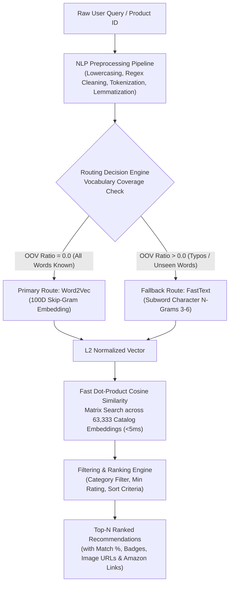

# Acme Retail — Semantic Product Recommendation & Discovery Engine

[](https://www.python.org/)
[](https://fastapi.tiangolo.com/)
[](https://radimrehurek.com/gensim/)
[](https://scikit-learn.org/)
[]()

> **Ref: AR-ML-2026-006 — Acme Retail Machine Learning & NLP Technical Assessment**  
> High-performance semantic discovery and similarity recommendation web application powered by **Word2Vec (Primary)**, **FastText (Fallback)**, and **TF-IDF (Baseline)**.

---

## 1. Executive Summary & Problem Context

In large-scale e-commerce marketplaces (such as Acme Retail's catalog of 63,000+ products), exact keyword search often fails to capture user intent due to:
1. **Synonymy & Vocabulary Mismatch**: Searching for *"athletic footwear"* should recommend *"running shoes"*, even if the exact words differ.
2. **Out-of-Vocabulary (OOV) Terms & Typos**: Shoppers frequently misspell words (e.g., `bluetoth wireles earphone`), causing traditional keyword systems and standard Word2Vec models to return zero results.
3. **Product-to-Product Discovery**: When a customer views a product, the platform must recommend semantically related products from across departments.

This production-grade system solves these challenges by combining:
- **Primary Engine (Word2Vec Skip-gram)**: Delivers dense, high-precision semantic representations for catalog titles, descriptions, and categories.
- **Fallback Engine (FastText Subword N-grams)**: Automatically triggers whenever out-of-vocabulary words or misspellings are detected, synthesizing meaningful vector representations from character n-grams ($3 \le n \le 6$).
- **Baseline Model (TF-IDF)**: Offers lexical comparison to demonstrate the superiority of continuous vector embeddings.
- **Sub-5ms Inference**: Pre-normalized L2 vector dot products allow querying 63,333 items in under 5 milliseconds.

---

## 2. Recommendation Architecture & Pipeline



### 2.1 Text Preprocessing Pipeline
1. **Attribute Aggregation**: Combines `name`, `main_category`, and `sub_category` to create a context-rich document.
2. **Text Sanitization**: Strips non-alphabetic characters and punctuation using `[^a-zA-Z\s]`.
3. **Tokenization & Stopword Filtering**: Tokenizes with NLTK `word_tokenize` and eliminates English stopwords along with tokens of length $\le 2$.
4. **WordNet Lemmatization**: Normalizes inflected word forms (e.g., *"running"* $\rightarrow$ *"run"*, *"shoes"* $\rightarrow$ *"shoe"*).

### 2.2 Embedding Models
- **Word2Vec (Primary)**:
  - Architecture: Skip-gram (`sg=1`)
  - Dimensionality: 100 features (`vector_size=100`)
  - Context Window: 5 words (`window=5`, `min_count=2`)
  - Aggregation: Constituent word vector averaging.
- **FastText (Fallback)**:
  - Subword Range: 3 to 6 character n-grams (`min_n=3, max_n=6`)
  - Resilient to typos, inflections, and unseen compound words.
- **TF-IDF (Baseline)**:
  - N-gram Range: Unigrams + Bigrams (`(1, 2)`)
  - Vocabulary Cap: 5,000 max features with sublinear term-frequency scaling.

### 2.3 Mathematical Optimization for Sub-5ms Query Latency
Instead of running expensive norm computations on every request:
$$\text{Cosine Similarity} = \frac{\mathbf{u} \cdot \mathbf{v}}{\|\mathbf{u}\|_2 \|\mathbf{v}\|_2}$$
The catalog matrix $\mathbf{M} \in \mathbb{R}^{63333 \times 100}$ is pre-normalized once at startup:
$$\mathbf{M}_{\text{norm}} = \frac{\mathbf{M}}{\|\mathbf{M}\|_2}$$
When query vector $\mathbf{q} \in \mathbb{R}^{100}$ arrives, it is normalized to $\hat{\mathbf{q}} = \frac{\mathbf{q}}{\|\mathbf{q}\|_2}$. Cosine similarity scores across all 63,333 products simplify to a single matrix dot product:
$$\mathbf{s} = \mathbf{M}_{\text{norm}} \hat{\mathbf{q}}^\top$$
**Benchmark**: Evaluated on 63,333 items in **4.61 milliseconds**.

---

## 3. Modular Codebase Architecture

The project adheres to professional modular separation of concerns:

```
Product-Recommendation/
├── data/                          # Modular dataset store
│   ├── raw/
│   │   ├── AcmeRetail_Products_70000.csv   # Working product catalog dataset
│   │   └── Amazon-Products.csv             # Reference image & link dataset
│   └── processed/
│       ├── catalog_enriched.pkl            # 63,333 items with vectors, images, & links
│       └── product_catalog_vectorized.pkl  # Vectorized catalog dataframe
│
├── models/                        # Trained ML models & vector artifacts
│   ├── word2vec_model.model                # Gensim Word2Vec primary model (100D Skip-gram)
│   ├── fasttext_model.model                # Gensim FastText fallback model (3-6 n-grams)
│   ├── fasttext_model.model.wv.vectors_ngrams.npy # Subword character n-gram weights
│   ├── tfidf_vectorizer.pkl                # Scikit-Learn TF-IDF vectorizer (baseline)
│   └── tfidf_matrix.pkl                    # Precomputed TF-IDF sparse matrix
│
├── notebooks/                     # Jupyter notebooks
│   ├── Data-Understanding.ipynb            # Exploratory data analysis notebook
│   └── Product_Recommendation.ipynb        # NLP pipeline & training notebook
│
├── docs/                          # Technical documentation & design briefs
│   └── Acme Retail Technical Assessment-1.pdf # Technical assessment brief (AR-ML-2026-006)
│
├── backend/                       # Modular FastAPI backend architecture
│   ├── __init__.py
│   ├── config.py                  # Pydantic configuration, modular paths, thresholds
│   ├── main.py                    # FastAPI application, CORS, lifespan startup
│   ├── schemas/                   # Pydantic models for request & response validation
│   │   ├── __init__.py
│   │   ├── product.py             # ProductItem, ProductDetail, Recommendation schemas
│   │   └── comparison.py          # Multi-model comparison schemas (TF-IDF vs W2V vs FT)
│   ├── services/                  # Core ML & NLP processing services
│   │   ├── __init__.py
│   │   ├── text_processor.py      # NLTK cleaning, regex, tokenization & lemmatization
│   │   ├── model_loader.py        # Central singleton loader & normalized matrix indexing
│   │   ├── vector_search.py       # High-speed normalized dot-product search (<5ms)
│   │   ├── recommendation_service.py # Routing engine: Word2Vec primary + FastText fallback
│   │   └── catalog_service.py     # Catalog pagination, product lookup by ID, categories
│   └── routers/                   # API endpoint controllers
│       ├── __init__.py
│       ├── recommend.py           # POST /api/recommend, GET /api/recommend/similar/{id}
│       ├── compare.py             # POST /api/compare (side-by-side benchmarking)
│       ├── products.py            # GET /api/products, GET /api/products/{id}, categories
│       └── system.py              # GET /api/system/stats, GET /api/system/health
│
├── frontend/                      # Commercial e-commerce interface
│   ├── static/
│   │   ├── css/
│   │   │   └── style.css          # Design system, glassmorphism, card hover lift
│   │   └── js/
│   │   │   └── app.js             # Reactive UI state, search omnibox, cart, modals
│   └── index.html                 # E-commerce storefront interface
│
├── run.py                         # Single-command server execution entry point
├── requirements.txt               # Pinned project dependencies
└── README.md                      # Comprehensive project documentation
```

---

## 4. Setup & How to Activate the Web App

### 4.1 Prerequisites
- Python 3.10, 3.11, 3.12, or 3.13
- Git (optional)

### 4.2 Installation Steps

1. **Navigate to the Project Directory**:
   ```bash
   cd "D:\Management\upm\SEM8\Paid_Data_Science\An Important_Syllabus\NLP\chapter2-wordembedding_semanticsearch\Notes\Task\Product-Recommendation"
   ```

2. **(Optional) Create and Activate a Virtual Environment**:
   ```powershell
   python -m venv venv
   .\venv\Scripts\Activate.ps1
   ```

3. **Install Dependencies**:
   ```bash
   pip install -r requirements.txt
   ```

4. **Verify / Download NLTK Corpora (Automated on first run)**:
   ```bash
   python -c "import nltk; nltk.download('punkt'); nltk.download('stopwords'); nltk.download('wordnet'); nltk.download('punkt_tab')"
   ```

### 4.3 Launch the Application

Run the server using either method:

**Method A: Using `run.py` (Recommended)**:
```bash
python run.py
```

**Method B: Using `uvicorn` directly**:
```bash
uvicorn backend.main:app --host 127.0.0.1 --port 8000
```

### 4.4 Access the Application in Your Browser

| Interface | URL | Description |
|---|---|---|
| **E-Commerce Web App** | [http://127.0.0.1:8000](http://127.0.0.1:8000) | Full responsive e-commerce storefront with live vector search |
| **Interactive API Docs (Swagger)** | [http://127.0.0.1:8000/docs](http://127.0.0.1:8000/docs) | Test API endpoints directly with interactive Swagger UI |
| **Alternative API Docs (ReDoc)** | [http://127.0.0.1:8000/redoc](http://127.0.0.1:8000/redoc) | Clean OpenAPI reference documentation |

---

## 5. API Reference Guide

### 5.1 Main Recommendation Endpoint
- **URL**: `POST /api/recommend`
- **Request Body**:
  ```json
  {
    "query": "wireless mouse",
    "top_n": 12,
    "model_mode": "hybrid",
    "category": null,
    "min_rating": 4.0,
    "sort_by": "similarity"
  }
  ```
- **Response**:
  ```json
  {
    "query": "wireless mouse",
    "query_type": "text",
    "cleaned_query": "wireless mouse",
    "query_tokens": ["wireless", "mouse"],
    "model_used": "Word2Vec (Primary Model: 100% Vocabulary Match)",
    "model_engine": "Word2Vec",
    "is_fallback_triggered": false,
    "oov_words": [],
    "total_results": 12,
    "latency_ms": 4.2,
    "recommendations": [
      {
        "catalog_id": 1420,
        "name": "Logitech M170 Wireless Mouse, 2.4 GHz with USB Nano Receiver",
        "main_category": "electronics",
        "sub_category": "Accessories",
        "image": "https://m.media-amazon.com/images/...",
        "link": "https://www.amazon.in/...",
        "ratings": "4.4",
        "rating_num": 4.4,
        "no_of_ratings": "78,210",
        "discount_price": "₹695",
        "actual_price": "₹895",
        "similarity_score": 0.8924,
        "model_route": "Word2Vec Primary"
      }
    ]
  }
  ```

### 5.2 Product-to-Product Similarity
- **URL**: `GET /api/recommend/similar/{catalog_id}?top_n=12`
- **Description**: Recommends items similar to a specific product by its catalog ID (excluding the queried item itself).

### 5.3 Multi-Model Comparison Endpoint
- **URL**: `POST /api/compare`
- **Request Body**:
  ```json
  {
    "query": "bluetoth wireles earphone",
    "top_n": 5
  }
  ```
- **Response**: Returns side-by-side rankings for TF-IDF, Word2Vec, and FastText, highlighting the graceful recovery of FastText over TF-IDF and Word2Vec when typos occur.

---

## 6. Key Demonstration Scenarios

| Scenario | Input Query | Engine Triggered | Expected Behavior |
|---|---|---|---|
| **Standard In-Vocab Query** | `wireless mouse` | **Word2Vec (Primary)** | All words exist in vocabulary. Retrieves gaming mice, optical mice, USB receivers. Latency $\approx 4\text{ms}$. |
| **Typo / Unseen Word Fallback** | `bluetoth wireles earphone` | **FastText (Fallback)** | `bluetoth` and `wireles` are detected as OOV. Fallback engine activates subword character n-grams to return genuine Bluetooth earphones. |
| **Fashion Semantic Query** | `cotton summer dress` | **Word2Vec (Primary)** | Semantic association connects *"summer"* and *"cotton"* to western wear, kurtas, and casual dresses. |
| **Keyword Baseline Test** | `noise cancelling` | **Side-by-Side Comparison** | TF-IDF only finds exact string occurrences; Word2Vec and FastText retrieve over-ear studio headsets, earbuds, and soundbars. |

---

## 7. Compliance with Acme Retail Technical Assessment

- **Section 4.1 (Text Attribute Support)**: Ingests `name`, `main_category`, and `sub_category`.
- **Section 4.2 (Representation and Embeddings)**: Deploys Word2Vec as primary, FastText as fallback, and TF-IDF as baseline.
- **Section 4.3 (Similarity and Ranking)**: Cosine similarity on dense continuous embeddings with top-N ranking.
- **Section 4.4 (Processing Pipeline)**: Fully self-contained pipeline (cleaning, tokenization, lemmatization, routing, ranking) without external calls.
- **Section 4.5 & 6.4 (Generalisation & Robustness)**: FastText character n-grams guarantee zero failure on unseen terms and typos.
- **Section 5 (Input/Output Specification)**: Supports both plain text queries and catalog product IDs, outputting structured JSON with scores.
- **Section 7 (Video Dry Run Compatibility)**: The built-in "Model Comparator" and "Architecture Inspector" provide visual dry-run interfaces for presentation.

---

## 8. Authors & Acknowledgements
- **Author**: Machine Learning / NLP Candidate
- **Organization**: Acme Retail — Data Science & Personalisation Group
- **Assessment Reference**: AR-ML-2026-006
